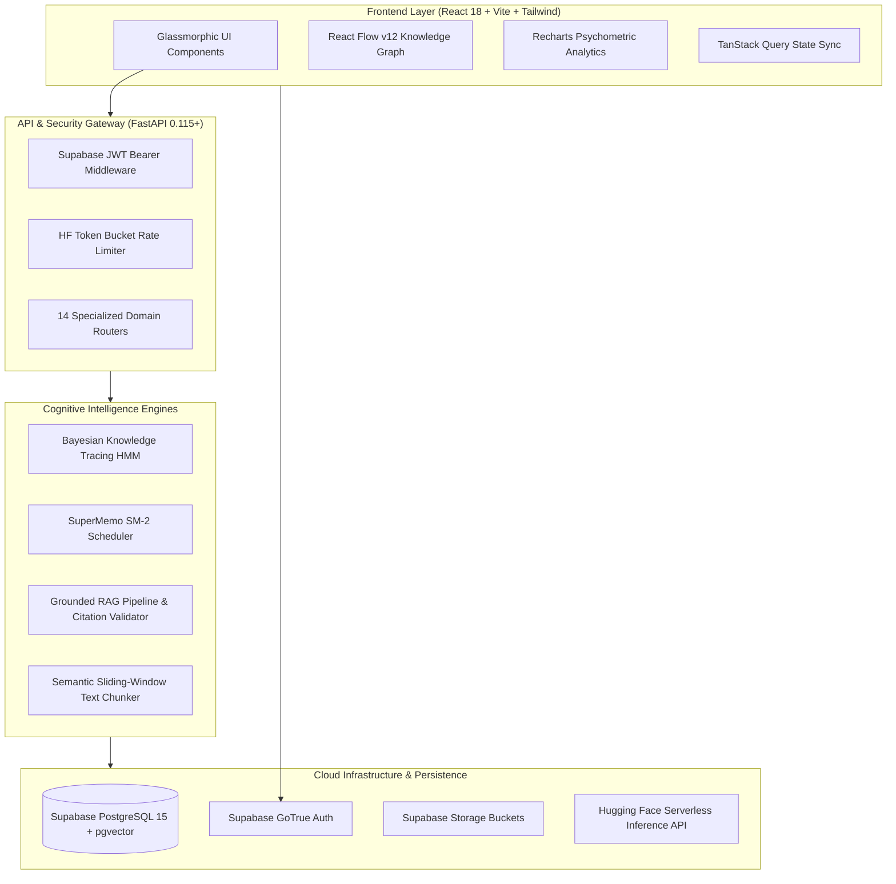

# Architecture Guide — Synapse Learning Intelligence Platform

Synapse is an AI-powered cognitive learning platform engineered for deep research, mastery tracking, and revision scheduling. The platform synthesizes retrieval-augmented generation (RAG), cognitive state estimation (Bayesian Knowledge Tracing), spaced repetition scheduling (SuperMemo SM-2), and multi-modal knowledge mapping within a light-only glassmorphism design system.

---

## 1. High-Level System Architecture

---

## 2. Frontend Layer Architecture

The frontend is constructed with modern React 18, TypeScript, Tailwind CSS, and Vite.

### 2.1 Design System Specification (DECISION-001)
- **Constraint**: Strict **Light-Only** Glassmorphism. Dark theme is strictly forbidden by specification to maintain cognitive focus, visual serenity, and consistent contrast ratios.
- **Background Base**: `#F7F8FC` / `#EEF2F6`.
- **Glass Surfaces**: Translucent white panels (`rgba(255, 255, 255, 0.70)` to `rgba(255, 255, 255, 0.90)`) with backdrop blur (`backdrop-blur-md` or `backdrop-blur-xl`).
- **Borders**: Subdued borders (`rgba(255, 255, 255, 0.60)` or `border-slate-200/60`).
- **Typography**: Inter / Outfit fonts with hierarchical weighting for academic reading comfort.
- **Accents**: Indigo (`#6366F1`), Violet (`#8B5CF6`), Emerald (`#10B981`), Amber (`#F59E0B`), and Rose (`#F43F5E`).

### 2.2 Key Interactive Modules
1. **Interactive Knowledge Graph (`/graph`)**: React Flow v12 canvas with custom glassmorphic nodes, interactive zoom, prerequisite dependency edges, and concept mastery badges.
2. **Adaptive Practice Center (`/practice`)**: Multiple choice, true/false, and short answer questions with progressive hint revelation, explanation breakdowns, and real-time BKT posterior recalculation.
3. **SM-2 Flashcard Trainer (`/flashcards`)**: Card flip 3D animation, queue management, quality rating grades (0 to 5), and immediate interval scheduling feedback.
4. **Study Planner & Calendar (`/planner`)**: Day, week, and month revision schedules with direct action links to practice quizzes and flashcard sessions.
5. **Project Knowledge Workspaces (`/projects`)**: Synthesis workspaces binding Markdown notes, PDF research papers, and concept subgraphs with Markdown export.
6. **Learning Analytics (`/analytics`)**: Recharts radar charts for subject mastery distribution, dual-axis cognitive load vs retention health trajectories, and weekly synthesis modal reports.

---

## 3. Cognitive Intelligence & Algorithmic Foundations

### 3.1 Bayesian Knowledge Tracing (BKT)

Synapse employs a standard two-state Hidden Markov Model (HMM) to maintain a probabilistic estimate of a learner's latent mastery state $L$ over concept $c$:
- $L = 1$: Concept is mastered.
- $L = 0$: Concept is not mastered.

#### Model Parameters:
- $P(L_0)$: Prior probability that the student has already mastered the concept before practice (default: 0.40).
- $P(T)$: Probability that the student transitions from unmastered to mastered state after practice (default: 0.15).
- $P(G)$: Guess probability — probability of answering correctly despite not having mastered the concept (default: 0.20).
- $P(S)$: Slip probability — probability of answering incorrectly despite having mastered the concept (default: 0.10).

#### Posterior Observation Update:
Given student response $O_t \in \{1 \text{ (correct)}, 0 \text{ (incorrect)}\}$:

$$\text{If } O_t = 1 \text{ (Correct): } \quad P(L_t | O_t = 1) = \frac{P(L_{t-1}) \cdot (1 - P(S))}{P(L_{t-1}) \cdot (1 - P(S)) + (1 - P(L_{t-1})) \cdot P(G)}$$

$$\text{If } O_t = 0 \text{ (Incorrect): } \quad P(L_t | O_t = 0) = \frac{P(L_{t-1}) \cdot P(S)}{P(L_{t-1}) \cdot P(S) + (1 - P(L_{t-1})) \cdot (1 - P(G))}$$

#### Latent Transition Update:
$$P(L_{t+1}) = P(L_t | O_t) + (1 - P(L_t | O_t)) \cdot P(T)$$

---

### 3.2 SuperMemo SM-2 Spaced Repetition

Synapse implements the SuperMemo-2 spaced repetition algorithm for flashcards, adjusting review intervals and easiness factors dynamically based on recall quality $q \in [0, 5]$:

1. **Repetition Count ($n$) & Interval ($I$)**:
   $$\text{If } q < 3: \quad n = 0, \quad I_1 = 1 \text{ day}$$
   $$\text{If } q \ge 3: \quad n = n + 1$$
   $$I_n = \begin{cases} 1 & \text{if } n = 1 \\ 6 & \text{if } n = 2 \\ \text{round}(I_{n-1} \cdot EF) & \text{if } n > 2 \end{cases}$$

2. **Easiness Factor ($EF$) Adjustment**:
   $$EF' = \max\left(1.3, \; EF + (0.1 - (5 - q) \cdot (0.08 + (5 - q) \cdot 0.02))\right)$$

---

### 3.3 Grounded Retrieval-Augmented Generation (RAG)

Synapse strictly prevents hallucinations by enforcing corpus grounding:
1. **Embedding**: `BAAI/bge-small-en-v1.5` 384-dimensional dense vectors stored in Supabase `pgvector`.
2. **Hybrid Retrieval**: Combines semantic cosine similarity search with BM25/lexical keyword matching across student notes and course documents.
3. **Strict Citation Grounding**: The assistant constructs numerical citation markers `[1]`, `[2]` linking directly to verified source chunk IDs, page numbers, and preview snippets. If candidate evidence falls below similarity thresholds, the system explicitly disclaims certainty.

---

## 4. Security & Multi-Tenant Isolation

1. **Row Level Security (RLS)**: Enforced across all 30 PostgreSQL tables via Supabase Auth `auth.uid() = user_id`.
2. **Zero-Trust Backend**: The FastAPI gateway inspects and cryptographically validates the Supabase JWT Bearer token on every protected endpoint.
3. **Data Segregation**: User Alpha cannot read, mutate, or delete notes, project workspaces, study sessions, or flashcards belonging to User Beta.

