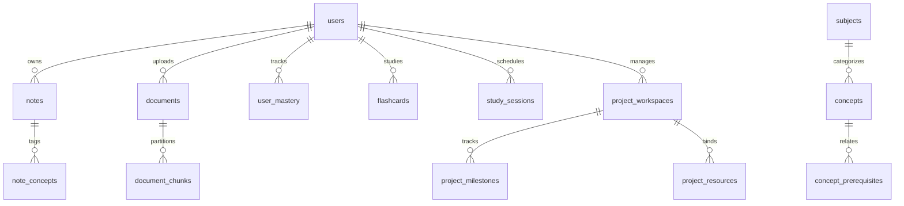

# Database Schema Reference — Supabase PostgreSQL 15

Synapse uses Supabase PostgreSQL 15 with `pgvector` for vector similarity search and Row Level Security (RLS) on all user-facing tables.

---

## 1. Schema Overview

The database is structured into 6 primary operational domains encompassing 30 relational tables:



---

## 2. Core Domains & 30 Relational Tables

### Domain 1: Authentication & User Profiles
1. **`profiles`**: User profile metadata (display name, avatar URL, academic institution, cognitive preferences, streak count, total study minutes).
2. **`user_settings`**: Interface and notification settings (glassmorphic intensity, sound effects, daily revision goals).
3. **`user_academic_goals`**: Active learning goals, target mastery thresholds, target weekly study hours.

### Domain 2: Academic Knowledge Graph & Subjects
4. **`subjects`**: Course disciplines (Machine Learning, Cognitive Science, Mathematics) with visual theme colors.
5. **`concepts`**: Atomic knowledge nodes with descriptions, Bloom taxonomy levels, and difficulty ratings.
6. **`concept_prerequisites`**: Directed acyclic graph edges linking concept dependencies ($A \rightarrow B$).
7. **`concept_resources`**: Recommended textbook chapters, video lectures, and documentation links.
8. **`concept_aliases`**: Alternative vocabulary, mathematical symbols, and abbreviations for semantic search matching.

### Domain 3: Research Notes & Document Library
9. **`notes`**: Rich Markdown student notes with frontmatter, word count, and reading time estimation.
10. **`note_tags`**: Normalized tags associated with student notes.
11. **`note_concepts`**: Many-to-many join table linking notes to extracted concepts in the knowledge graph.
12. **`documents`**: PDF files uploaded to Supabase Storage, with file metadata, page counts, and indexing status.
13. **`document_chunks`**: Text segments generated via sliding-window chunker with page numbers and token counts.
14. **`document_embeddings`**: Dense 384-dimensional vector embeddings (`vector(384)`) for semantic cosine search.

### Domain 4: Conversational AI & Grounded RAG
15. **`ai_conversations`**: Chat thread sessions between learner and Synapse assistant.
16. **`ai_messages`**: Individual user and assistant turns with message role, content, and token counts.
17. **`ai_citations`**: Verified source provenance linking assistant assertions to `document_chunks` or `notes`.
18. **`ai_extracted_concepts`**: AI-extracted conceptual candidates pending learner confirmation.

### Domain 5: Psychometrics, Mastery & Practice
19. **`user_mastery`**: Probabilistic Bayesian Knowledge Tracing parameters ($P(L), P(T), P(G), P(S)$) per concept.
20. **`mastery_history`**: Audit trail of Bayesian posterior updates across practice sessions.
21. **`knowledge_gaps`**: Identified conceptual deficits and blocking prerequisite bottlenecks.
22. **`practice_questions`**: Item bank questions (MCQ, True/False, Short Answer) with explanations and hints.
23. **`question_choices`**: Multiple choice answer options with distractor explanations.
24. **`practice_submissions`**: Student attempt logs with response times, hints used, and correctness.
25. **`flashcard_decks`**: Thematic or concept-based collections of spaced repetition flashcards.
26. **`flashcards`**: Front, back, and hints for atomic fact retention.
27. **`flashcard_reviews`**: SuperMemo SM-2 log of quality ratings ($0-5$), intervals, and easiness factors.
28. **`learning_paths`**: Sequenced step-by-step curricula generated to bridge identified knowledge gaps.

### Domain 6: Temporal Planning & Workspaces
29. **`study_sessions`**: Scheduled calendar revision blocks with session type, target questions, and completion timestamps.
30. **`project_workspaces`**: Multi-modal research projects unifying notes, papers, concept nodes, and milestones.

---

## 3. Row Level Security (RLS) Policies

All user-owned tables enforce strict Row Level Security to prevent horizontal privilege escalation (NFR-04).

### Standard User Isolation Policy Example
```sql
-- Enable RLS
ALTER TABLE notes ENABLE ROW LEVEL SECURITY;

-- Users may only view their own notes
CREATE POLICY "Users can select own notes"
ON notes FOR SELECT
USING (auth.uid() = user_id);

-- Users may only insert notes with their own UID
CREATE POLICY "Users can insert own notes"
ON notes FOR INSERT
WITH CHECK (auth.uid() = user_id);

-- Users may only update their own notes
CREATE POLICY "Users can update own notes"
ON notes FOR UPDATE
USING (auth.uid() = user_id)
WITH CHECK (auth.uid() = user_id);

-- Users may only delete their own notes
CREATE POLICY "Users can delete own notes"
ON notes FOR DELETE
USING (auth.uid() = user_id);
```

### Public Educational Material Policy Example
```sql
-- Subjects and foundational concepts are viewable by all authenticated users
CREATE POLICY "Authenticated users can read subjects"
ON subjects FOR SELECT
TO authenticated
USING (true);

CREATE POLICY "Authenticated users can read concepts"
ON concepts FOR SELECT
TO authenticated
USING (true);
```

---

## 4. Vector Indexes (`pgvector`)

Cosine distance similarity search on `document_embeddings` is accelerated via an IVFFlat index:

```sql
CREATE EXTENSION IF NOT EXISTS vector;

CREATE INDEX idx_document_embeddings_cosine
ON document_embeddings
USING ivfflat (embedding vector_cosine_ops)
WITH (lists = 100);
```

